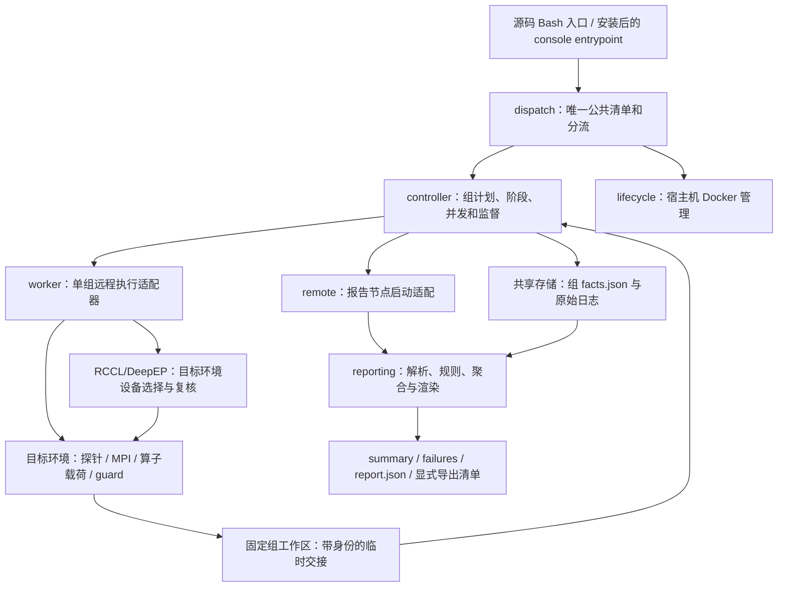
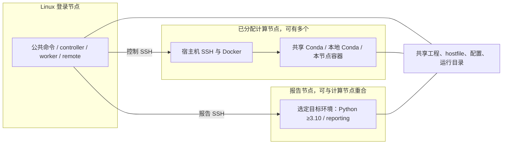
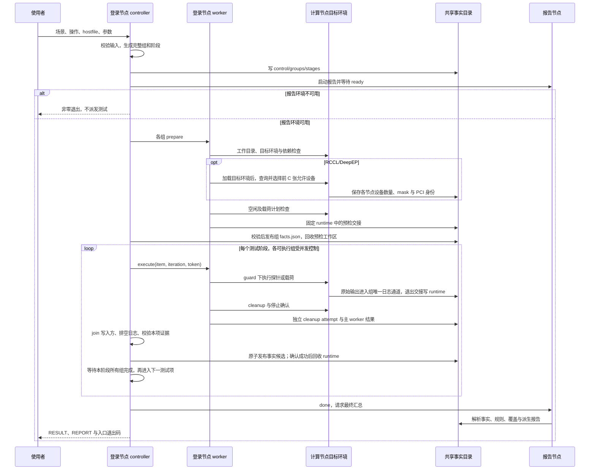

<!--
Copyright (c) 2026 Hygon Information Technology Co., Ltd.
SPDX-License-Identifier: Apache-2.0
-->

# hcu-envcheck 总体设计与运行约定

本文对应当前 `0.4.2` 源码，集中说明目标、总体架构、执行流程、调度、载荷接口、配置与结果协议；运行示例见 [USER_GUIDE](USER_GUIDE.md)，文件职责见 [PROJECT_STRUCTURE](PROJECT_STRUCTURE.md)，已知缺陷和未验证范围见 [KNOWN_LIMITATIONS](KNOWN_LIMITATIONS.md)。本文描述当前实现与应维持的接口约定，已知缺陷仍以原问题清单管理，不因文档迁移而关闭。

## 目录

- [产品目标与能力边界](#产品目标与能力边界)
- [总体架构](#总体架构)
- [核心执行流程](#核心执行流程)
- [分组与调度](#分组与调度)
- [检测与载荷设计](#检测与载荷设计)
- [容器生命周期设计](#容器生命周期设计)
- [结果与恢复设计](#结果与恢复设计)
- [扩展与发布边界](#扩展与发布边界)
- [附录环境准备](#附录环境准备)
- [附录场景与环境脚本](#附录场景与环境脚本)
- [附录参数参考](#附录参数参考)
- [附录故障排查](#附录故障排查)

## 产品目标与能力边界

工具用于从登录节点对大规模 HCU 集群进行大模型训练前的基础环境检查、通信测试和算子测试。节点由外部系统分配；当前三种目标环境为共享 Conda、各节点本地 Conda、各节点独立 Docker 容器。超大规模是产品目标，源码中的并发和目录优化不构成已完成规模验收的证据。

| 需求 | 公共操作 | 核心实现 | 范围 |
|---|---|---|---|
| 平台与资源 | platform、resource、platform,resource | worker、pod_probe、健康规则与 reporting | 逐节点采集、规则判定、静态一致性 |
| HCU 空闲检测与释放 | idle-check、--release | idle_check、idle_check_node | 宿主机逐节点零值判断、占用归属、停止与复查 |
| DeepEP 前置检查 | checkdeepep | check_deepep_env | 容器场景，逐节点 |
| 容器管理 | container-status/create/recreate/delete | Bash lifecycle | 宿主机 Docker 显式操作，命令使用完整 container- 前缀 |
| RCCL | rccl | rccl_perf_test、test_rccl | 单机/多机十项 collective 与准确卡数基准 |
| DeepEP | deepep | deepep_test、run_deepep_test | 单机 intranode 支持配置 2/4/8 卡；多机 lowl/norm 每节点八卡，完整组限 2/4 节点 |
| 算子测试 | byte-flux | flux_70b_test | 单机 TP4、64 项矩阵 |
| 保留扩展 | ib-write-bw | target_ib、extra_checks、Python CLI | IB 带宽 |

公共清单共 13 项，以 `cluster_run/dispatch.sh` 为唯一来源；当前不公开 Kubernetes/Pod、独立 GEMM 或 model 操作。部分旧 Python 类仍是活跃依赖，不能仅按文件历史判断冗余。

## 总体架构

### 逻辑分层



| 层 | 责任 | 主要边界 |
|---|---|---|
| 公共接口 | 场景、操作、参数与路由 | 内部 Python 参数不自动成为公共 Bash 参数 |
| 调度控制 | 完整分组、阶段计划、组并发、任务监督 | 不申请计算资源，不替换故障组成员 |
| 远程执行 | 环境引导、单组命令、节点结果与清理 | worker 适配器在登录节点，真实负载在计算节点 |
| 采集与载荷 | 原始数据、目标设备选择、MPI/torchrun/算子执行 | 各节点独立核对可见设备，保持 rank 所有权与 token 边界 |
| 规则与报告 | 将执行事实转换为健康/性能及覆盖结论 | 不补跑测试，不把缺数据重新解释为成功 |
| 存储与分发 | 工程可见性、事实文件、报告和运行资源 | 不自动安装训练依赖，不提供通用挂载翻译 |

### 部署关系



默认报告节点为原 hostfile 第一个节点，也可独立指定；选择报告节点不把它加入被测列表。容器场景中报告进程在同名容器内运行；Conda 场景中在选定脚本环境运行。所有相关环境必须可访问同一事实目录。

核心 Bash 操作与容器管理不要求登录节点 Python；完整 Python 帮助及当前 `--rerun-plan` 除外。目标探针和报告仍需要相应 Python；RCCL/DeepEP 设备选择也在各目标环境使用 Python 与 HIP runtime。安装 console script 将公共命令交给同一 dispatch；内部 Python 入口的 RCCL/DeepEP 同样转交 Bash controller，使用同一规模协议。

组事实候选的序列化复用选定报告目标环境的 Python，不增加登录节点 Python/jq 依赖。候选辅助命令使用普通 SSH 许可，不占用清理保留许可；辅助进程结束后由登录节点主 controller 原子发布。

### 控制、数据与运行环境

| 通道 | 内容 | 维护要求 |
|---|---|---|
| 控制通道 | 登录节点到宿主机/报告节点 SSH | 与组并发、控制 SSH 额度区分，保留失败原因 |
| 组内启动与通信 | 目标环境之间 SSH、MPI、rendezvous 和通信数据流 | 容器互联端口与外部登录端口分开；不能用控制 SSH 额度推断 MPI 连接上限 |
| 证据通道 | 共享目录中的计划、节点日志、退出与清理事实 | 目标可写、登录用户可读；不删原始事实只保留报告 |
| 环境引导 | 目标 workdir、env-script、报告解释器与路径映射 | 目标环境与控制器环境分开配置，不猜测 Conda 路径 |

## 核心执行流程

### 分阶段操作



当前预检失败会隔离组；部分全局配置损坏被错误分类为组故障的问题仍保留。普通单项失败可以继续后续项，但清理未确认的组不能视为已可安全继续。图中是阶段协议，不代表每条超时与清理缺陷均已消除。

### 检测、容器与保留路径

| 路径 | 执行流程 | 结论形成位置 |
|---|---|---|
| platform/resource | pod_probe 采集 → 规则判定 → 静态一致性 → 汇总 | 目标节点采集，报告节点判定 |
| RCCL/DeepEP/byte-flux | prepare → 按测试项/模式执行 → 每组清理 → 阶段推进 | 执行事实与报告解析分开 |
| 容器管理 | 宿主机检查 → 按显式操作维护 → 结果及汇总 | Bash lifecycle；创建/重建/删除合并终端同类结果，保留逐节点明细；不生成分阶段报告 |
| IB | Bash 组调度 → 组首 target_ib → 既有成对测试实现 | 目标环境执行，报告路径汇总 |

具体文件定位与复用关系见 [PROJECT_STRUCTURE](PROJECT_STRUCTURE.md)。

## 分组与调度

RCCL 和 DeepEP 按 hostfile 顺序，仅执行完整组。节点总数为 N、组大小为 G 时，执行 `floor(N/G)` 组，末尾剩余节点不预检、不派发、不清理，不计入任务分母，也不记为失败或 NA。报告中的通过结论只覆盖参与节点。

| 节点数 | group-size | 实际测试 | 未参与 |
|---|---|---|---|
| 3 | 1 | node001、node002、node003 各一组 | 无 |
| 3 | 2 | node001 + node002 | node003 |
| 3 | 3 | node001 + node002 + node003 | 无 |
| 3 | 4 | 没有完整组，派发前返回非零 | 全部；dry-run 同样不能通过 |

上表说明分组算法；具体载荷仍须满足能力约束，例如当前完整多机 DeepEP 不允许 G=3。

已计划的组发生节点故障时不能缩组、补节点或减少计划任务分母。`platform/resource/platform,resource/checkdeepep/byte-flux` 均为每节点一组，`--group-size` 只能为 1。IB 每组至少两节点，不能套用 RCCL/DeepEP 的余数跳过规则。

控制器先 prepare，再逐阶段执行；RCCL 测试项在外层，组并发在内层，当前阶段执行和清理处理完成后才进入下一阶段。DeepEP 单机执行一次 intranode，多机分别执行一次 lowl、norm；byte-flux 每组执行一次完整的 64 项矩阵。清理未确认的组应阻断后续阶段，普通单项性能失败可继续保留后续项证据。

`--concurrency` 限活跃组；Bash ≥5.1 时滚动补位，较老版本部分路径退回批次等待。`--node-concurrency` 限普通控制 SSH，报告与清理有独立通道设计；当前仍存在清理和限流边界缺陷，不能把参数值当作严格连接数或总耗时保证。

### 测试规模与设备选择

RCCL、DeepEP 统一采用两个独立的正整数参数：`--group-size G` 表示每组节点数，默认 1；`--gpus-per-node C` 表示每节点参与卡数，默认 8。公共 `--slots`、`--nproc-per-node` 已删除，不保留兼容别名。用户 hostfile 只提供节点成员，出现 `slots=` 时提前拒绝。其他操作不因该接口获得 GPU 配置能力；byte-flux 仍固定单机 TP4。

控制器把 C 显式传给 worker，再传给 RCCL 载荷或 DeepEP 的 `HCU_GPUS_PER_NODE`。控制器在 `.state/prepared/<group>/slotsfile` 持久化分组分配：RCCL 每行 `node slots=C`、多机 `np=G×C`；DeepEP 每行 `node slots=1`、多机 `np=G`。多机启动直接使用 `mpirun --hostfile <该 slotsfile 的绝对路径>`，载荷核对槽位后使用，不再生成临时 MPI hostfile。单节点组直接启动，没有 MPI 层。

`hcu_envcheck/payloads/device_selection.py` 在各参与节点的容器或 Conda 环境运行，流程为：

1. 切换目标目录并加载目标 env-script 后，通过 HIP runtime 查询实际可见设备数量和 PCI 身份。
2. 已设置 `HIP_VISIBLE_DEVICES` 时保留候选顺序，取前 C 张；未设置时在目标实际可见范围内选择。已有 CUDA/ROCR 限制继续保留，不能删除限制扩大范围。候选不足、重复、无效或运行时身份不一致则预检失败。
3. 将各节点选择暂交到 `.state/runtime/<group>/devices/<node>.json`，包括 C、mask 和 PCI 列表；预检完成后由 C 集中提交到该组 `facts.json` 的 devices 表。不同节点可以使用不同物理编号，不从登录节点探测或统一广播组首的设备列表。
4. 执行时加载相应节点环境，复核当前允许范围和保存的设备身份，再设置该 mask 并按 argv 启动测试。记录不匹配时失败，不重新默认成八卡。

为保持 rank 与载荷参数稳定，执行仍使用 `.state/prepared/<group>/devices/<node>.json` 作为虚拟定位路径：设备读取器从相邻的 `facts.json` 取对应节点选择，不要求长期存在同名节点 JSON。没有 compact facts 的历史运行继续读取独立设备记录；已有 facts 损坏时直接报错，不退回旧副本隐藏错误。

例如目标 env-script 设置 `HIP_VISIBLE_DEVICES=4,5,6,7`、C=4 时，测试中的逻辑设备编号 0..3 对应选定的物理卡。环境变量列表和实际 HIP 可见设备均需核对，不能只修改字符串或只传 C。执行日志中的 `DEVICE-SELECTION` 表示执行前实际复核的可见性，不是 GPU 工作进程已全部启动的证明。

设备选择不改变空闲检查规则：默认仍检查空闲脚本可见的原有设备范围；`--skip-idle-check` 不跳过设备选择、数量和身份复核。当前预检及 MPI 环境传播仍需目标集群运行验收，不能以源码或 dry-run 宣称硬件通过。

### rank 与工作进程所有权

| 载荷 | 组级启动 | 节点内工作进程 | 公共参数含义 |
|---|---|---|---|
| RCCL 单机 | 直接二进制 | 一个进程，`-g C` 使用 C 张可见卡 | G=1，C 默认 8 |
| RCCL 多机 | 一层 mpirun，np=G×C | 每节点 C 个 rank，每卡一个；不带 -g | G 为节点数，C 为每节点卡数 |
| DeepEP 单机 | run_deepep_test.sh intranode | Python 测例 `--num-processes C`，上游 spawn C 个 worker | G=1，当前 C=2/4/8 |
| DeepEP 多机 | G 个 MPI 控制 rank | 每节点 torchrun nproc=1，测例 `--num-processes C`，上游 spawn C 个 GPU worker | 当前 C=8、G=2/4 |
| byte-flux | 上游 launch_tp4 | 单机 TP4 | G=1，不支持 gpus-per-node 配置 |

同一任务的多层启动不能重复放大 GPU 工作进程数。公共节点分组、hostfile 的 MPI 槽位及实际 GPU worker 数分别核对。

## 检测与载荷设计

### 平台、资源与前置环境

命令示例见 [platform](USER_GUIDE.md#platform) 和 [resource](USER_GUIDE.md#resource)。

`pod_probe.py` 在各节点目标环境采集原始数据，报告端复用规则给出结论：

- `platform`：系统、驱动/运行时、设备、软件和网络信息；当前结构规则要求 `torch`，未配置站点版本基线，也未把编译器/RDMA/RCCL/UCX 全部设为强制项。
- `resource`：当前默认采样 3 次、间隔 1 秒；卡显存使用率或利用率超过 5%，且达到 2 次采样的 quorum 时判忙。当前未强制固定卡数，也未提供全套 CPU/内存/磁盘健康阈值。
- 一致性：比较采集到的静态配置与设备信息，动态负载不作为配置差异。缺失节点记录的覆盖仍有限制，应同时检查参与节点和检查明细。

采集进程退出 0 仅说明执行成功；健康规则、跨节点一致性和清理状态共同影响报告结论。当前存在 N/A 条目归类及采样命令异常处理缺口，不能只凭一个 PASS 作上线结论。

DeepEP 前置检查独立于主动测试：

公共命令名为 `checkdeepep`，示例见 [checkdeepep](USER_GUIDE.md#checkdeepep)。旧命令名 `check_deep` 保留为兼容输入；公共入口映射到现有内部 `check_deep` 阶段和报告标识，检测脚本 `check_deepep_env.sh` 保持不变。

该操作仅容器场景，逐节点检查 ACS、XDP、RDMA 和 `ibv_devinfo` 等；检查脚本退出 2 时可形成 WARN。它不运行 DeepEP 算子，也不能证明多机通信或算子正确性。

### RCCL

#### 单机和多机

命令示例见 [USER_GUIDE](USER_GUIDE.md#rccl)。

单机直接运行 rccl-tests 二进制并传入卡数；多机只使用一层组级 `mpirun`，每卡一个 rank，不使用 torchrun。默认按以下顺序执行十项：

```text
all_reduce all_gather broadcast reduce reduce_scatter
gather scatter alltoall alltoallv sendrecv
```

#### 基准与环境

基准模板为 [`rccl_baseline.conf.example`](../cluster_run/baselines/rccl_baseline.conf.example)，行格式为：

```text
<计划参与总卡数> <测试项> <实测基准busbw_GB/s> [容差百分比]
```

基准规模按 G×C 计算：单机四卡为 4、双机每节点四卡为 8、双机每节点八卡为 16，均需覆盖全部十项。目标设备数量在预检中核对，实际执行规模另从二进制 Rank/设备输出验证。基准必须为正数，容差范围 `[0,100)`，同一规模与测试项不重复；未提供对应规模或项目时不能借用其他规模。模板注释中的数值不能直接作为本集群达标基线。

RCCL 通信参数与库路径可在环境脚本中设置，也可提供站点配置：复制 [`cluster_env.conf.example`](../cluster_run/cluster_env.conf.example) 为私有配置，并用 `CLUSTER_ENV_FILE` 选择。此模板包含历史字段，不是控制器通用配置文件；当前读取它的是 RCCL 载荷。通信与测量配置使用已激活环境变量 → 站点默认 → 载荷内置默认；通信参数不通过 CLI 覆盖。卡数统一来自公共 C，旧 `DEFAULTS_SLOTS` 不再决定 RCCL 规模。建议显式传 `--baseline-file`，不依赖自动查找。

常规环境配置放在 `--env-script` 指定的脚本中。worker 先在组首目标环境加载脚本，再启动载荷；多机 MPI 各 rank 执行共享 `rank-body.sh` 时也先 source 该脚本，随后恢复工具选定的通信参数并启动二进制。它不是要求用户自行拼接一段 `mpirun ... bash -c`。

例如在已准备的目标环境脚本中按实际部署设置以下变量：

```bash
# 环境脚本片段；路径、网卡及拓扑文件按目标环境填写
export RCCL_BIN_DIR=/opt/rccl-tests/build
export NCCL_SOCKET_IFNAME=eth0
export UCX_NET_DEVICES=ib0
export NCCL_TOPO_FILE=/shared/hcu-config/topology.xml
export RCCL_MARGIN=1
export RCCL_ARG_B=4 RCCL_ARG_E=1G RCCL_ARG_F=2
export RCCL_ARG_N=20 RCCL_ARG_W=5
```

这些环境变量分别配置二进制目录、通信接口/拓扑、容差以及消息大小和迭代次数。G/C、超时和其他调度参数仍由公共命令控制，不通过环境变量代替。常规入口固定完整十项，不提供用户选择诊断子集的参数或环境变量；载荷内部 `--tests` 仅供逐阶段执行与历史重跑使用，不从用户参数转发。

#### 判读

报告分别保存 out-of-place/in-place 的 algbw、busbw 四列独立峰值；性能判据为两种 busbw 中的峰值 ≥ 对应基准 × `(1-margin/100)`，全局默认 margin 为 1%，可按项覆盖。四列没有各自独立基准，不应把单列阈值套在四列上。

当前消息尺寸完整性和实际 rank 归属验证仍有缺口；必须同时核对原始尺寸序列、全部 rank、正确性错误数、有效结论及清理证据，不能单凭峰值 PASS 证明完整通过。

### DeepEP

#### 节点数、卡数与模式

G 表示每组节点数，C 表示每节点卡数，默认 G=1、C=8，二者不互相替代。单节点组运行 intranode，当前允许 C=2/4/8；测例父进程通过 `--num-processes C` 创建 GPU worker。只限制 `HIP_VISIBLE_DEVICES` 不会自动改变上游 spawn 数量，必须同时传递 C。

命令示例见 [USER_GUIDE](USER_GUIDE.md#deepep)。

测试经工程内 `hcu_envcheck/payloads/run_deepep_test.sh` 启动。多机链路为组首 mpirun → 每节点一个 MPI 控制 rank → run_deepep_test.sh → `torchrun --nproc-per-node=1` → 一个测例父进程 → 上游 `spawn` 创建 C 个 GPU worker。C 显式传过 worker、payload、MPI rank 和适配器，最终传给 `test_low_latency.py` / `test_internode.py` 的 `--num-processes C`；不能把 C 填入 torchrun 的 nproc 参数再次放大进程数。

当前 norm 要求每节点 GPU worker 数为 8，因此完整多机测试必须 C=8。默认专家数 norm=256、lowl=288，二者均需被总 GPU ranks G×C 整除；保持固定矩阵时，多节点 G 仅允许 2 或 4。这些约束在远程预检前拒绝，不先运行 lowl，不跳过 norm，也不修改第三方断言或专家数扩大范围。G=2、C=4 因此不受支持。

在目标环境安装匹配的 DeepEP/rocSHMEM 依赖；默认查找 `third-party/DeepEP/tests`，也可由环境脚本设置 `HCU_DEEPEP_TEST_DIR`。工具不自动编译或下载扩展。入口和工作脚本的命名与职责见[载荷目录](PROJECT_STRUCTURE.md#载荷目录)。

#### 执行次数与覆盖

每组单机执行一次 intranode，多机分别执行一次 lowl、norm。保留上游测例自身的 warmup 和测量迭代，工具不追加预热或完整测试重跑，也不进行跨轮带宽稳定性判定。超时、清理未确认及模式缺失不得计为完整通过。当前指标组合、dtype/rank 覆盖及重复行检测不足，应核对原始日志和期望配置，不能把“解析到指标”当作全部正确性已验证。

上述卡数与节点组合来自当前固定测例的源码约束，不表示已在目标集群完成硬件验收，也不表示支持任意超大规模的单个 DeepEP 组。大集群可形成多个完整的受支持组，仍需验证整体调度与清理能力。

### byte-flux

公共操作名为 `byte-flux`，当前测试为单机 TP4；工程不提供独立 GEMM 公共操作。它使用独立的算子矩阵与结果判定。

命令示例见 [USER_GUIDE](USER_GUIDE.md#byte-flux)。

默认 timeout 为 4800 秒。每组执行一次完整 sweep，包含 16 个 M 值和四类形状，共 64 项；保留上游测例的 warmup 和测量迭代，工具不追加预热或完整测试重跑：

| 类型 | 形状 | 固定参数 |
|---|---|---|
| AG | `M×10240`、`M×57344` | K=8192，float16，50 次测量、5 次 warmup |
| GemmRS | `M×8192×8192`、`M×8192×28672` | float16，50 次测量、5 次 warmup |

M 为 `2048,2176,2304,2560,3072,4096,4160,4352,4608,5120,6144,8192,16384,32768,65536,131072`。当前通过上游 `launch_tp4.sh` 执行；固定端口可能影响并行运行其他同节点任务。

目标环境需安装匹配的 flux 与 PyTorch/HIP 扩展。默认从 `third-party/flux/model_tests/training` 查找测试，可设置 `HCU_FLUX_TEST_DIR`。当前重试和事件完整性解析有缺口，验收应核对 64 项各自 start/结果、sweep 结果和原始失败记录。

### IB 带宽检测

#### IB 带宽

本节记录当前保留实现，不纳入核心操作命令手册。

IB 默认把全部节点作为一组，也可显式 `--group-size`；每组至少两节点，不能出现只有一节点的尾组。工具在组内按 HCA/方向运行 server/client，不使用 MPI；组内 `--ib-concurrency` 与入口组并发分开。容器端口从 sshd 启动参数发现，不使用 RCCL/DeepEP 的 `--container-ssh-port` 作为该操作参数。

| 参数 | 默认 / 含义 |
|---|---|
| `--ibstat-command` | `ibstat` |
| `--ib-tool` | `ib_write_bw`，另可选 `ib_read_bw`、`ib_send_bw` |
| `--ib-protocol` | `ib` 或 `roce` |
| `--ib-device`、`--ib-port` | HCA 设备及端口，端口默认 1 |
| `--ib-gid-index` | RoCE GID 索引，按部署配置 |
| `--ib-control-port` | 默认 18515 |
| `--ib-message-bytes` | 默认 1048576 |
| `--ib-iterations` | 默认 1000 |
| `--ib-minimum-gbps` | 显式带宽下限；未设置不能宣称满足站点性能基准 |
| `--ib-concurrency`、`--ib-max-tests` | 默认 1 和 1024 |

## 容器生命周期设计

四个完整操作名只用于 `per-node-container`。`container-status` 检查已有容器运行状态和镜像标签，不拉取镜像；create/recreate 在各目标节点优先复用 `-i/--image` 指定的本地镜像，明确缺失时才拉取；显式 `--image-tar` 保持归档导入优先，随后均核对镜像 ID。检测命令不会隐式修复容器。

### 查询与创建

命令示例见 [USER_GUIDE](USER_GUIDE.md#容器操作)。

create/recreate 必须显式给出 `--port`，多机 RCCL/DeepEP 使用同一值作为 `--container-ssh-port`。镜像需含 SSH 服务与客户端。宿主机使用 host 网络；默认启用设备访问、privileged、host IPC、64G shm，并只读挂载 `/opt/hyhal` 和 `/root/.ssh`。显式添加工程/结果所在共享目录挂载。

默认挂载不会自动建立节点间信任关系，也不自动分发密钥。创建后有 sshd 启动与身份文件回读流程；完整的超时、失败汇总及身份边界尚待整改。container-status 只核对状态和镜像标签，不能据此证明跨容器 SSH 身份正确，见能力边界。

### 重建与删除

命令示例见 [USER_GUIDE](USER_GUIDE.md#容器操作)。

重建会删除旧容器及容器可写层，删除会强制移除指定容器；挂载目录内容应另行管理。当前 recreate 对旧容器 ID 的格式校验错误，通常会在预检拒绝已有容器；delete 仍有按名称操作的竞态。当前版本不建议把它们用于无人值守的批量环境恢复。

| 专用参数 | 含义 |
|---|---|
| `--port N` | create/recreate 必需的容器 SSH 监听端口 |
| `--image-tar PATH` | 计算节点宿主机可见的离线镜像归档绝对路径 |
| `-v/--volume HOST:CONTAINER[:ro]` | 追加挂载，可重复 |
| `--docker-arg=VALUE` | 追加一个 Docker 参数，可重复；与固定网络/用户/挂载等冲突的参数会被拒绝 |
| `--yes` | 真实 recreate/delete 必需的破坏性操作确认 |
| `--dry-run` | 只打印计划，不执行 Docker 操作 |
| `--concurrency N` | 默认 32；不等同于事务或失败回滚保证 |
| `-o/--output-dir DIR` | 创建/重建/删除的本地明细目录父路径，默认工程根目录 `verify_results`；相对路径从当前工作目录解析 |
| `--log-detail milestone/every/quiet` | 创建/重建/删除默认合并同类结果；every 显示逐节点原始明细；quiet 仅显示异常、汇总与日志路径 |

当前 Bash 容器路由不支持把 Python 内部的 `--container-command`、`--no-preset` 等视为可用功能。容器操作不生成分阶段 `summary.md`。

### 终端合并与逐节点明细

创建、重建和删除在各阶段完成后，由登录节点父进程统一输出。默认只合并阶段、状态、原因码、原始退出码、镜像配置及原因说明均相同的结果，容器 ID 不参与合并。不同失败原因分行显示，汇总计数和操作退出码沿用原有逻辑。参数错误与 dry-run 直接输出；查询保留原有逐节点输出。

全部计划节点同类时显示 `nodes=ALL`；部分节点按 hostfile 顺序列出，仅把相邻且同前缀、同数字宽度的连续节点名折叠为范围，不补入未测试节点。各节点先写独立暂存日志，父进程在阶段结束后收集，避免并发终端输出交错。

`lifecycle-details.log` 保留逐节点 `[NODE-RESULT]`、原始错误、容器 ID 和 SSH 身份证据；运行结束打印 `LOG` 路径。明细在登录节点保存，不要求该目录挂载进容器。`every` 也从这些日志输出，`quiet` 不隐藏明细文件。结果目录布局见 [USER_GUIDE](USER_GUIDE.md#容器创建重建与删除)。

## 结果与恢复设计

### 结果目录

Bash 分阶段操作的目录示例见 [USER_GUIDE 结果目录](USER_GUIDE.md#结果目录)。

新 Bash 运行采用 `compact-group-v2`：分组和阶段计划只保存一份，持久事实集中到每组 `facts.json`。执行时只为活动组创建固定 `.state/runtime/<group>/`；同组下一项沿用相同路径，完成且确认提交后该目录可以被删除再创建。`stages/<stage>/groups/<group>/task.tsv` 等是报告读取的逻辑地址，不再要求每项保留一套物理目录。原始输出始终保存在运行根部 `group-NNN.log`，派生 RCCL 组明细在 `.state/prepared/<group>/rccl-summary.md` 与同目录的 `rccl-summary.tsv`。

旧运行继续按原有 prepared/stages、节点日志及日志索引布局读取，不原地转换、补跑或删除历史文件。定位问题时保留整个运行目录；不要删除 `.state` 后再期待报告可重建。当前未解决的报告和结果索引问题仍见 [KNOWN_LIMITATIONS](KNOWN_LIMITATIONS.md)。

终端默认交互面板，非 TTY 追加快照；`every` 增加逐组快照，`quiet` 减少过程显示，三者均不等于原始日志实时流。当前无顶层 `results.tsv`。

### 状态、覆盖与清理

当前派生结果协议为 v3；新组 facts 采用 schema 2，运行级 control/groups/stages 继续使用原有 TSV 接口。历史 schema 1 的逐任务 TSV 仍可读取。历史多轮运行的各阶段仍可读取和重建，但不再重新计算跨轮稳定性；原有 `stability.tsv` 保留为历史产物，不作为新版判定输入。新正常运行不创建多轮阶段，内部 iteration 字段保留为事实兼容字段。需要分别判读：

| 维度 | 判读方式 |
|---|---|
| 执行 | 是否计划、实际启动、形成终态，原始命令退出码是什么 |
| 规则 / 性能 | PASS、WARN、FAIL；查看具体 check、reason_code、基准和有效指标 |
| 未执行 / 不完整 | BLOCKED、CANCELLED、INCOMPLETE、PENDING、RUNNING 不计通过 |
| 不适用 | NA 不等于 PASS，不计有效验收结论 |
| 超时 | TIMEOUT 需结合目标时限与原始退出证据；137 还可能来自 OOM 或外部 SIGKILL |
| 清理 | CONFIRMED 才表示当前记录确认停止；UNCONFIRMED 需继续处理，SSH 返回不等于远端已退出 |
| 覆盖 | 计划、执行、终态、有效结论分开；余数未参与节点不代表已检查 |

有效结论计数使用 PASS/WARN 且清理 CONFIRMED，但 WARN 仍需人工确认，不能把有效结论数量直接称为“全部通过数量”。不同运行、不同子集的覆盖不得简单拼成同一次完整验收。

### 退出码

| 路径 | 退出码与含义 |
|---|---|
| 正常分阶段收尾 / report-only 的报告结论 | PASS=0，WARN=2，FAIL=1 |
| 参数错误或报告环境启动失败 | Bash 路径通常为 2；不代表健康 WARN，结合 stderr 与控制状态判断 |
| 报告 Python 内部异常 / 正常收尾缺少有效报告结果 | 70；是工具报告失败，不是载荷性能结论 |
| report-only 的 SSH/环境启动层失败 | 可直接返回启动层原始码，如 SSH 255 |
| 分阶段 Ctrl+C / SIGTERM | 130，并尝试清理；仍须检查远端清理证据 |
| 公共帮助、版本、有效 Bash dry-run | 0；没有测试通过含义 |
| 入口 Python 包装配置错误 / 无可用解释器 | 部分配置错误为 3；保留路径找不到 Python ≥3.10 为 69 |
| 生命周期操作 | status/delete 执行失败通常为 1；create/recreate 执行失败通常为 2；参数错误为 2；当前 stopped 查询可打印 WARN 但整体返回 PASS/0 |

任务事实的 `exit_code` 是任务层结果码，不是整条入口命令的退出码；`execution_exit_code` 保留 worker 的执行结果，两者可能因取消、清理或日志错误而不同。历史运行对应字段在 `task.tsv`；compact 运行由 facts.tasks 通过同一逻辑接口提供。超时原始 124、取消或被杀信号应与 reason_code 和清理证据一起判断。现有超时、容器汇总和 N/A 归类的验证边界仍见能力边界。

### 执行事实与写入责任

| 数据 | 写入方 | 读者 / 用途 |
|---|---|---|
| `.state/control.tsv` | 主 controller C | 全局配置、状态和 `state_layout=compact-group-v2` / `log_format=direct-group-v3` 标识 |
| `.state/groups.tsv`、`stages.tsv` | C，运行内各一份 | 固定节点顺序、组成员和子项计划，重建及重跑依据 |
| `.state/prepared/<group>/slotsfile` | C，运行内每组一份 | RCCL slots=C；DeepEP slots=1；其他操作保留 hostfile |
| `.state/prepared/task-guard.sh` | C，在派发前发布一次 | worker 和目标 rank 只读使用的公共进程 guard |
| `.state/prepared/<group>/facts.json` | 仅 C 原子发布 | 各组累计事实，reporter、设备读取器和重建/导出读取 |
| `.state/prepared/<group>/.facts-candidate.*.json` | 目标 Python 辅助进程 | 唯一命名候选，关闭、校验并返回摘要；辅助进程不发布 facts |
| 组适用的 rank 脚本 | 目标载荷经 state_runtime 缓存 | 相同正文复用；正文变化保留不可变版本，实际命令始终引用对应版本 |
| `.state/runtime/<group>/identity.tsv` | C | 当前任务 group/stage/phase/item/iteration/token；派发前发布 |
| 同一 runtime 下的节点退出、worker、deadline、cleanup attempt 交接 | 各指定写方 | 每行有 group/stage/phase/token；worker-result 仅 worker 主进程写 |
| `runtime/<group>/logs.tsv`、`collector-result.tsv` | 组包装器收尾 | 已排空的本项精确日志范围、长度、SHA256 与收集结果 |
| 根部 `group-NNN.log` | 每活动组唯一 cat 收集进程 | 开始、真实命令、原始 stdout/stderr、清理与结束的持久原始输出 |
| `.state/report.json`、preflight.tsv、组 RCCL 汇总 | reporting | 派生结果；不修改执行事实或设备选择 |
| 根部 `summary.md`、`failures.tsv` | reporting | 对外摘要和异常 |
| 四种导出清单 | reporting/export | 显式 report-only 导出；不触发重测 |

facts 使用 `schema_version`、`group`、单调增加的 `revision` 和按用途组织的 `tables`。各表采用 `fields+rows`，不额外维护同内容的 JSON 快照或事件日志，也不复制原始测试输出：

| 表 | 保存内容 |
|---|---|
| tasks | 预检与各阶段的 token、执行状态、时间、退出码、原始执行码、清理与原因 |
| nodes | 各阶段逐节点退出码、清理状态和逻辑日志地址 |
| devices | 本组各节点的 C、HIP mask 和 PCI 身份，一次选择跨子项复用 |
| rccl_plan | 完整十项 RCCL 预检基准计划及对应规模 |
| execution | 各 RCCL 项实际执行退出码、耗时与日志地址 |
| cleanup | 按 stage/token/source/attempt 保存逐节点停止证据；guard 返回对象结构化保存 |
| timeout | 独立的 watchdog 与节点 deadline 到期证据 |
| logs | 逻辑 source 对应根部组日志的精确 offset、length、SHA256；相同范围的别名共用记录 |
| ib | IB 操作已有的结构化结果，保留其节点与任务身份 |

C 对每个组串行发布元数据，组测试和节点 SSH 仍按既有并发执行。目标辅助进程只生成包含预期 revision 的候选；C 检查返回身份、版本和 SHA256，原子发布并确认后才回收该项交接。reporter 通过同一兼容读取层投影逻辑 TSV 和日志路径；单次快照固定各组已发布版本，后续快照按文件 inode/ctime/mtime/size 和 revision 失效缓存，不从旧缓存沿用终态。事实损坏应报错，不能用残留旧 TSV 掩盖。

报告、原位重建、导出及报告状态更新共用 `.state/report.lock`，锁覆盖完整派生写入周期。锁文件保持同一个 inode，不与 JSON 数据混用，不在正常回收时 unlink 或替换。内容缓存不能消除全部解析与序列化开销；规模目标与真实验收证据仍须分开。

十个通用节点、group-size=2 会形成五个固定组。以下为 RCCL、concurrency=2 的结构示意；它只说明元数据与目录关系，不表示十节点硬件验证：

```text
<run>/
├── group-001.log
├── group-002.log
├── group-003.log
├── group-004.log
├── group-005.log
└── .state/
    ├── control.tsv
    ├── groups.tsv
    ├── stages.tsv
    ├── report.lock
    ├── prepared/
    │   ├── task-guard.sh
    │   ├── group-001/
    │   │   ├── slotsfile              # node001、node002，RCCL 各 slots=C
    │   │   ├── facts.json
    │   │   └── rccl/rank-body.sh
    │   ├── group-002/
    │   │   ├── slotsfile              # node003、node004
    │   │   ├── facts.json
    │   │   └── rccl/rank-body.sh
    │   ├── group-003/
    │   │   ├── slotsfile              # node005、node006
    │   │   ├── facts.json
    │   │   └── rccl/rank-body.sh
    │   ├── group-004/
    │   │   ├── slotsfile              # node007、node008
    │   │   ├── facts.json
    │   │   └── rccl/rank-body.sh
    │   └── group-005/
    │       ├── slotsfile              # node009、node010
    │       ├── facts.json
    │       └── rccl/rank-body.sh
    └── runtime/
        ├── group-001/                 # 当前活动组，固定路径
        └── group-002/                 # 当前另一活动组，固定路径
```

五个 prepared 组一直对应同一计划；正常 runtime 数量只随当前活动组变化，受 concurrency 限制，不随完成子项数成套累积。异常保留的现场另计，可能使 runtime 数量超过当时的活动组数。rank 正文变化产生的必要不可变脚本版本、原始日志字节、facts 行数和派生报告可以增长，不能把“固定工作区”解释为所有文件和证据大小恒定。

### 计划规模与实际执行证据

`hcu_envcheck/reporting/scale.py` 为报告、导出及重跑提供统一的计划规模解析。它只处理元数据，不查询设备或启动测试。新运行在 control.tsv 保存规模字段，在 report.json 的 `planned_scale` 中发布：

| 字段 | 含义 |
|---|---|
| `group_size`、`gpus_per_node` | 每组节点数 G、每节点卡数 C |
| `planned_gpus_per_group` | 计划每组总卡数 G×C |
| `mpi_ranks_per_group` | 计划 MPI ranks：多机 RCCL 为 G×C，DeepEP 为 G；单机为 0，表示没有 MPI 层 |
| `planned_deepep_gpu_workers_per_node` | 仅 DeepEP，计划每节点 C 个 GPU worker |

计划字段不能证明实际进程已经启动。RCCL 的 `actual_np`、`actual_nodes`、`devices_per_node` 仍来自二进制 Rank/设备证据；`device_visibility_evidence` 来自执行前 HIP 数量与身份复核，只证明该时刻可见性。当前没有完整唯一的 DeepEP GPU worker 身份证据，`actual_gpu_worker_count` 为 null，摘要标为未知，不把计划 G×C 填成实际数量。

### 报告重建与导出

使用终端输出的真实运行目录替换命令示例中的 EXISTING_RUN。使用原场景、操作、容器/环境和报告节点。当前入口在进入 report-only 前仍要求可读 hostfile 并进行部分分组校验，因此应保留原 hostfile 和分组参数。

命令示例见 [USER_GUIDE](USER_GUIDE.md#报告重建导出与重跑预览)。

重建不运行探针、载荷或清理，只读取原运行分组/阶段事实并更新派生报告。它会写入报告相关文件，并与实时报告共用稳定 report.lock。新 facts、旧逐任务 TSV、旧 log-archive/log-stream 索引及 direct-log 指针使用同一读取接口；历史 prepared/hostfile 与当前 slotsfile 均保留读取兼容，不需要转换原运行。报告节点默认第一个 hostfile 节点；原运行显式用了 `--report-host` 时应继续传同一值。当前尚未锁定完整解释器/脚本/工作目录身份，应保留原始记录后再重建。

需要失败清单时，在同一命令中显式追加全新、绝对且报告环境可写的导出目录：

命令示例见 [USER_GUIDE](USER_GUIDE.md#报告重建导出与重跑预览)。

导出目录不能预先存在。导出文件为：

| 文件 | 用途 |
|---|---|
| `failed-nodes.hostfile` | 失败相关节点清单，不能据此默认缩组重测 |
| `failed-groups.json` | 失败组项及其原成员、阶段上下文 |
| `unfinished-groups.json` | 未执行或未完成组项 |
| `cleanup-unconfirmed.json` | 清理未确认清单；不是可直接重跑的授权 |

重建原报告为 FAIL 时，即使导出文件已成功写出，入口仍可返回 1；不要把报告失败结论与导出过程失败混为一谈。

### 重跑计划

当前支持读取 `failed-groups.json` 或 `unfinished-groups.json`；先使用 dry-run 核对，不把导出内容或日志中的 fingerprint 提示当成完整环境一致性证明。

命令示例见 [USER_GUIDE](USER_GUIDE.md#报告重建导出与重跑预览)。

此模式从清单加载组与阶段，不再用当前 hostfile 重新分组；hostfile 必须仍包含计划成员，阶段范围由清单决定。RCCL/DeepEP 不同时传 `--group-size`、`--gpus-per-node`。其他操作原有禁止用 `--slots` 覆盖清单的规则保留。该模式与 `--report-only/--export-plan` 互斥。DeepEP/byte-flux 重跑清单在同组同模式/测试项下只能包含一个原阶段；包含多个轮次的同项阶段会被拒绝，需另建单次测试。若旧清单每项仅选中一个原阶段，可执行一次并保留原 stage_id/iteration 身份。

新 RCCL/DeepEP 导出清单使用 schema 2，明确保存 G/C、派生计划规模与 `group-nodes-gpus-v1` 语义，重跑时恢复原值；导出的节点文件只写节点名。其他操作及旧运行导出仍使用 schema 1。底层执行 TSV schema 和派生报告协议不是该导出 schema，不能混用版本号。

历史报告仍按原事实读取，不需要为了重建补写卡数。历史计划重跑时，scale.py 仅在保存的 RCCL 各组显式 slots 分配与 rccl-plan.tsv 的 np 能共同确认统一 C 时转换；异构卡数、分配缺失或证据不一致则拒绝。仅有旧 slots 的 DeepEP 计划无法确定 GPU worker 数，拒绝猜测，也不重新开放旧 CLI。原部署版本门禁保留：旧代码导出的清单须先由当前代码重新导出，但重新导出不能弥补缺失的原始规模证据。

真实重跑会创建新运行目录和新 token，原运行证据应保留；存在清理未确认时应拒绝实际派发。当前配置指纹、成员/卡数、仅预检失败清单及混合失败阶段的校验还不完整，应由维护者核对原始计划、镜像、环境脚本、基准和成员规模后决定如何重测，暂不用于无人值守恢复。

## 扩展与发布边界

### 发布与依赖

| 文件 / 目录 | 约定 |
|---|---|
| `VERSION` | 当前源码/离线包版本；文档同步不自行升版 |
| `pyproject.toml` | Python ≥3.10、console entrypoint、Python 包及 Shell/payload 资源 |
| `setup.py` | 构建时临时纳入仓库级 LICENSE、NOTICE、THIRD_PARTY_NOTICES.md |
| `MANIFEST.release` | 离线发布白名单，含 docs、cluster_run、hcu_envcheck 等；不自动包含 third-party |
| `install.sh` | 检查发行清单后复制到版本目录并建立唯一命令链接；不使用 pip 或网络安装依赖 |
| `.gitattributes`、`.gitignore` | 换行、生成产物与私有站点配置管理 |
| `third-party/DeepEP`、`third-party/flux` | 独立组件源码/版本与许可；不能按原创代码覆盖其声明 |

源码运行、离线复制安装、Python 包安装是不同分发形态。console entrypoint 已与公共 dispatch 对齐，但安装包是否完整、资源是否可读和真实运行是否兼容仍须独立验证，不能仅由源码可运行推断。

当前第三方来源、版本固定和 NOTICE 完整性仍需收尾；不要在不了解来源/许可时自动执行 `git submodule update --remote`、下载替代组件或宣称开源合规已完成。新增/修改第三方内容遵循仓库 [CONTRIBUTING](../../CONTRIBUTING.md) 与 [第三方声明](../../THIRD_PARTY_NOTICES.md)。

### 变更同步

| 变更 | 首先检查 | 同步文档 |
|---|---|---|
| 新公共操作 / 参数 | dispatch 唯一清单、实际路由校验与执行层 | DESIGN 的参数表与 USER_GUIDE 命令；README 能力表 |
| 新载荷 / 启动方式 | worker、guard、rank 所有权、超时与逐节点清理 | DESIGN 载荷/数据流，PROJECT_STRUCTURE 文件表与 USER_GUIDE 命令 |
| 健康规则 / 性能判据 | 采集内容、纯规则、parser、NA/缺失处理 | DESIGN 判读与 KNOWN_LIMITATIONS |
| 新结果字段 / 状态 | 执行事实、parser、aggregate、render/export | DESIGN 协议与 USER_GUIDE 结果目录 |
| 重跑 / 配置指纹 | export 与 rerun 校验对称、原始计划与环境身份 | DESIGN 重跑、USER_GUIDE 命令与能力边界 |
| 文件删除 / 移动 | 所有导入、Shell 路径、内部 Python 调用与分发资源 | PROJECT_STRUCTURE 职责表、链接和发布说明 |
| 发布内容 | package-data、MANIFEST、法律文件及安装布局 | 发布边界；真实构建/安装证据单独记录 |

维护者应保留执行事实与派生报告的边界，不把异常、缺数据、未测试或清理未知降为成功。公开示例不得包含真实站点账号、内部地址和私有基准；结构文档描述当前事实，未来设计与待整改事项单独标明。

## 附录环境准备

### 运行位置和依赖

工具不申请节点，也不创建 Slurm allocation。先通过集群资源管理系统取得测试节点，确认使用权限和空闲状态，再在登录节点运行命令。当前公共接口没有 Kubernetes/Pod 场景，也没有独立 `gemm` 或 `model` 操作。

| 位置 | 基础依赖 | 按操作增加的依赖 |
|---|---|---|
| Linux 登录节点 | Bash、SSH 客户端、GNU 常用工具；分阶段运行需要 `setsid`，SSH 限流需要 `flock` | `--help-full` 需要 Python ≥3.10；当前 `--rerun-plan` 也需要登录节点 `python3` |
| 计算节点宿主机 | SSH 可达、目标目录可访问、用户有相应权限 | 容器场景需要 Docker，容器管理需要拉取/加载镜像及 Docker 管理权限 |
| 被测容器或 Conda 环境 | Bash、`timeout`、`setsid`、`flock`、共享工程/结果目录 | 平台/资源探针使用 `python3`；资源采集需要 `hy-smi`、`rocminfo`；RCCL/DeepEP 各参与环境还需 Python 和可加载的 `libamdhip64.so` 进行设备复核；RCCL 需要测试二进制，多机需要 MPI/SSH；DeepEP/byte-flux 需要匹配的 PyTorch/HIP 与已安装扩展 |
| 报告节点的目标环境 | Python ≥3.10 标准库、工程可导入、可读取并写入结果目录 | 默认第一个 hostfile 节点；可用 `--report-host` 单独选择，不加入被测节点列表 |

核心 Bash 调度和容器管理不要求登录节点有 Python；这不代表计算节点或报告节点不需要 Python。推荐使用 Bash ≥5.1 以启用滚动补位；较老 Bash 的部分等待路径按批运行，应在目标发行版验证兼容性。

多机 RCCL/DeepEP 需要目标环境之间的 SSH 和 MPI 通信已经可用。宿主机 SSH 端口由 SSH 配置管理；容器间 SSH 端口由 `--container-ssh-port` 指定。两者与登录服务器的外部登录端口是不同配置。

### 源码使用与离线安装

可直接使用完整源码目录中的入口，不要求先用 pip 安装：

```bash
cd /shared/cluster-manager-das/hcu-envcheck
bash bin/hcu-cluster-run --version
bash bin/hcu-cluster-run --help
```

上传 Shell 文件时保留 LF。所有计算节点及容器必须能访问实际执行的工程、分组 hostfile 和结果目录；仅在登录节点保存源码不足以运行。

如已获得维护者构建的离线发行包，可在 Linux 解压后执行复制式安装：

```bash
tar -xzf hcu-envcheck-0.4.2.tar.gz
cd hcu-envcheck-0.4.2
bash install.sh --prefix "$HOME/.local"
export PATH="$HOME/.local/bin:$PATH"
hcu-cluster-run --version
```

安装器要求发行包内存在 `RELEASE-MANIFEST.sha256`，不能把普通源码目录当作已构建发行包。安装不下载 PyTorch、MPI、RCCL、DeepEP、flux 或镜像；这些依赖须另行准备。离线包构建与依赖边界见[发布与依赖](#发布与依赖)。

### 准备节点文件

命令手册示例均从 `/shared/cluster-manager-das/hcu-envcheck` 执行；该路径、节点、镜像、端口和配置目录都是通用示例，执行前按实际部署替换。

```bash
cd /shared/cluster-manager-das/hcu-envcheck
cat > hostfile <<'EOF'
node001
node002
node003
EOF
```

用户 hostfile 每行只写一个主机名或 IPv4 地址；支持空行和以 `#` 开头的注释。RCCL/DeepEP 拒绝 `slots=N` 或其他非注释附加字段，卡数只从 `--gpus-per-node` 获取。节点必须唯一，按文件顺序分组。公共 Bash 路径不展开 `node[001-003]`、Slurm 表达式或带 `user@host:port` 的写法。SSH 用户默认取当前用户，可用 `HCU_SSH_USER` 指定；宿主机连接细节在 SSH 配置中维护。

用户输入的 RCCL/DeepEP hostfile 只写成员名，无需填写 slots。工具在各组目录生成 `slotsfile`，分组多机运行直接将它交给 MPI。以 G=2、C=4 的 RCCL 为例，两行为 `node001 slots=4`、`node002 slots=4`，np=8；G=2、C=8 的 DeepEP 则两行均为 `slots=1`、np=2。报告导出兼容历史组目录中的 `hostfile`；重跑在新目录按计划 G/C 生成 `slotsfile`，不改写原结果。`groups.tsv` 为兼容历史保留 `hostfile` 列名，该列记录实际文件路径。节点文件、MPI 控制槽位和 GPU 卡数各有职责，见[测试规模与设备选择](#测试规模与设备选择)。

## 附录场景与环境脚本

| 场景 | 含义 | 配置方式 |
|---|---|---|
| `shared-conda` | 各节点使用共享存储中的 Conda 环境 | 在各目标节点 source 同一绝对路径的环境脚本 |
| `node-local-conda` | 各节点使用各自本地 Conda 环境 | 所有节点同一路径部署脚本，脚本激活本地环境；逐节点检查版本和依赖 |
| `per-node-container` | 每个节点使用同名、已运行的 Docker 容器 | 显式提供 `--container` 和 `-i/--image`；容器内源码、结果和必要配置可见 |

`--env-script` 可选，仅在目标执行环境中 source，登录节点不加载它。目标工作目录切换后再加载环境脚本；省略时使用目标 Shell 的现有环境，工具不猜测环境脚本或 Conda 安装位置。当前环境加载失败处理仍有缺陷，见[已知限制](KNOWN_LIMITATIONS.md)。

环境脚本可以显式激活 Conda、设置库路径及扩展目录，例如：

```bash
# /shared/hcu-config/train-env.sh；在目标节点或容器内执行
source /opt/conda/etc/profile.d/conda.sh
conda activate train
export RCCL_BIN_DIR=/opt/rccl-tests/build
export HCU_DEEPEP_TEST_DIR=/opt/DeepEP/tests
export HCU_FLUX_TEST_DIR=/opt/flux/model_tests/training
```

共享 Conda 与本地 Conda 使用相同命令形态：

命令示例见 [USER_GUIDE](USER_GUIDE.md#resource)。

容器内工程路径与登录节点不同，可用 `--container-workdir` 指定容器内工程根目录。只对工具根目录下的相关路径进行映射；工程外的 `--output-dir`、环境脚本和基准文件需要使用在各环境中均可访问的路径，不自动推导宿主机挂载前缀。

报告默认继承 `--env-script`，可分别指定 `--report-env-script`、`--report-python`、`--report-workdir`。报告环境要有 Python ≥3.10；`--controller-env-script`、`--controller-python` 仅用于登录节点的保留 Python 路径，不能代替目标环境配置。

## 附录参数参考

```text
hcu-cluster-run <scenario> <operation> -f HOSTFILE [options]
```

源码用 `bash bin/hcu-cluster-run` 调用；安装后的同名命令将公共参数转到同一 `dispatch.sh`。不要把 `python -m cluster_run` 或 `--help-full` 的全部 Python 参数用于公共 Bash 操作。

公共清单共 14 个操作：

| 类别 | 操作 | 路由 |
|---|---|---|
| 基础检测 | `platform`、`resource`、`platform,resource`、`checkdeepep` | Bash 分阶段控制器 |
| 主动测试 | `rccl`、`deepep`、`byte-flux` | Bash 分阶段控制器 |
| 容器管理 | `container-status`、`container-create`、`container-recreate`、`container-delete` | Bash 生命周期脚本，仅容器场景 |
| 保留扩展 | `ib-write-bw` | IB 走 Bash controller 和目标 IB 适配器 |

### 分阶段操作参数

本表适用于基础检测、主动测试和 IB；容器与 Python 扩展的专用参数见各自章节。没有列出的旧参数不能仅凭 Python 帮助认定可用。

| 参数 | 含义 / 默认值 | 适用限制 |
|---|---|---|
| `-f/--hostfile FILE` | 必需，可读节点文件 | `--report-only` 当前也必须提供 |
| `--container NAME`、`-i/--image IMAGE` | 目标容器名及期望镜像标签 | 容器场景必需；检测不 pull/create |
| `--env-script PATH` | 目标环境脚本，默认不加载 | 目标绝对路径 |
| `--container-workdir PATH` | 容器内工程根目录 | 容器绝对路径 |
| `--report-host HOST` | 默认 hostfile 第一个节点 | 可独立于被测列表；仍需可访问同一运行目录 |
| `--report-env-script PATH` | 默认继承 `--env-script` | 报告环境脚本绝对路径 |
| `--report-python PATH` | 默认在报告环境查找 `python3`、`python` | Python ≥3.10；不改变探针使用的 `python3` |
| `--report-workdir PATH` | 默认目标工程根目录 | 报告节点的工程绝对路径 |
| `-o/--output-dir DIR` | 默认工程根目录下 `verify_results` | 保存运行子目录；目标环境共享可写 |
| `--group-size G` | 正整数，每组节点数 | RCCL/DeepEP 默认 1，且只运行完整组；IB 默认全部节点；其他逐节点操作须为 1 |
| `--gpus-per-node C` | 正整数，每节点参与卡数，默认 8 | 仅 RCCL/DeepEP；单机 DeepEP 允许 2/4/8，多机 C=8 且 G=2/4 |
| `--slots N` | 其他操作仍保留的遗留解析与记录字段，不控制其实际卡数或启动进程数 | RCCL/DeepEP 拒绝；不作为新命令示例中的规模配置 |
| `--concurrency N` | 活跃节点/组任务上限，默认 32 | 当前校验上限 1024 |
| `--node-concurrency N` | 普通控制 SSH 的共享额度，默认 32 | 当前校验上限 1024；不限制 MPI 数据面连接 |
| `--timeout SECONDS` | 单次组项命令时限，通常默认 300 秒 | byte-flux 默认 4800 秒；不含全部阶段和完整清理总耗时 |
| `--container-ssh-port N` | 多机目标环境互联 SSH 端口，默认 25901 | RCCL/DeepEP；容器场景应与创建端口一致 |
| `--baseline-file PATH` | RCCL 性能基准文件 | 目标绝对路径，按实际总卡数匹配 |
| `--log-detail milestone/every/quiet` | 默认 milestone | 面板/快照粒度，不是载荷日志流 |
| `--skip-idle-check` | 显式跳过主动测试空闲检查 | 只用于已确认空闲的诊断；常规示例不添加 |
| `--dry-run` | 输出分组与阶段计划后退出 | 不执行探针、载荷、容器操作或清理验证；保留 Python 操作的计划输出单独判断 |
| `--report-only RUN_DIR` | 从已有事实重建派生报告 | 不执行被测任务；会写报告文件 |
| `--export-plan DIR` | 重建时导出四种失败/未完成清单 | 仅与 report-only 配合，绝对路径且目标不能存在 |
| `--rerun-plan FILE` | 加载失败/未完成 JSON 清单 | 与 report-only/export-plan 互斥；当前有使用限制 |

RCCL/DeepEP 不支持公共 `--nproc-per-node`；内部 torchrun 的 `--nproc-per-node=1`、MPI hostfile 的 `slots=N` 和第三方测例的 `--num-processes C` 继续按各自协议使用。DeepEP 完整测试的 G/C 限制来自固定测例约束，增加 `--concurrency` 不会扩大单组能力。

共享解析器仍出现 `--slots` 是保留其他操作原行为的结果，不代表 RCCL/DeepEP 还有旧别名，也不表示 IB 会据此启动更多进程。遗留公共参数、内部 MPI `slots=N` 和历史报告 slots 字段应分别处理，不能按同名字段一并删除。

公共 Bash 操作不接受旧 `--expected-devices`、`--rdma-policy-file`、`--profile`、`--launcher`、`--strict-size` 等参数作为其功能扩展。`--transport` 由保留 Python 路径使用，不是当前 Bash 核心操作的公共可选传输实现。

## 附录故障排查

| 现象 | 优先核对 |
|---|---|
| 参数被拒绝 | 是否使用公共操作名；是否混用 Bash、生命周期与 Python 内部参数 |
| 容器不存在、镜像不匹配 | 先执行 container-status，明确镜像标签和运行状态；测试不会自动创建容器 |
| 报告节点不可用，未派发测试 | 报告环境 Python ≥3.10、共享工作目录、写权限、选定 report-host；不要只检查登录节点 Python |
| 预检阻断组 | `.state/prepared/<group>/facts.json` 的预检/节点/设备/计划，异常时保留的 runtime；旧布局查看逐任务 TSV；不缩组规避 |
| 多机 MPI/DeepEP 卡住 | 目标环境之间的 SSH 端口、信任关系、网络接口、库路径与 rendezvous 端口 |
| RCCL 峰值低或日志不完整 | rccl-tests 二进制/实际卡数、基准规模、插件/拓扑、消息尺寸及全部 rank |
| resource 显示忙 | 查多次采样和实际占用；停止无关负载或重新分配空闲节点，不默认跳过检查 |
| 有 PASS 但覆盖不足 | 计划/执行/终态/有效计数、余数节点、NA、诊断子集、DeepEP 模式、flux 64 项 |
| 超时后远端仍有任务 | 按本次 token 与逐节点清理证据核查；不要用宽泛的进程名 pkill 处理共享节点 |
| 公开日志索引路径打不开 | 从运行根部 `group-NNN.log` 与组 facts 查精确逻辑范围；旧布局查看 prepared/stages 及原索引，保留整个目录 |

提交问题时提供版本、公共命令、场景、参与节点/组规模、退出码、报告摘要、相关 reason_code 与脱敏后的原始证据。真实账号、内部地址、镜像凭据和私有基准应按[仓库安全流程](../../SECURITY.md)处理，不贴到公开 issue。

## 分组日志与临时状态收尾

每个分组只在运行目录根部保留一份 `group-NNN.log`。预检和每项测试按顺序追加：带测试项名称的标题、分组节点和启动节点、目标场景/容器/镜像、环境脚本、开始时间、命令及实时原始输出、结束状态和清理结论。byte-flux 的每个矩阵小项也有独立标题与分割线。

RCCL 多机日志分别展示实际测试二进制参数与完整 MPI 启动 argv；DeepEP 展示 MPI 命令及组首节点的 torchrun 测试命令。命令块以 `【MPI 启动命令｜…】` / `【实际测试命令｜…】` / `【执行命令｜…】` 开始，以 `【命令结束】` 结束，保留旧 `[COMMAND-BEGIN]` / `[COMMAND-END]` 的读取兼容，报告提取错误时跳过这些展示内容，避免把命令文本当作运行错误。测试原始输出不做摘要或二次嵌套；执行成功不替代健康、正确性及性能判定。

RCCL 的 rank 脚本在组内跨测试项复用，task guard 在运行内共享；DeepEP 的 lowl/norm 使用同一组 rank 脚本。脚本内容变化时发布带内容哈希的不可变版本，不覆盖已记录命令指向的旧脚本。节点顺序和 MPI slots 值仍来自 `slotsfile`。

每个活动组通过 `runtime/<group>/log.pipe` 汇聚输出，由一个 cat 进程连续追加根部组日志。wrapper 的开始/结束、worker、目标命令和 Python IB 原始输出都使用继承通道，不各自打开根日志。FIFO 使用内核背压，收集不缓存整项输出；关闭所有输出 FD 并 join 收集者后才计算本项范围和 SHA256。嵌套 Python 命令的片段身份通过同一通道交付，最终索引集中提交到 facts.logs，不长期保留每项一份索引文件。

正常清理交付到 `cleanup-normal-1/`，独立兜底清理交付到 `cleanup-fallback-1/`；各自包含 result.tsv、nodes.tsv 和逐节点 guard 原始证据。不同来源/attempt 不共享临时文件或完成标记。节点退出、worker-result、watchdog、节点 deadline 与清理交接都携带 group/stage/phase/token；worker-result 只由 worker 主进程发布，signal/EXIT 收尾不能让子 shell 或第二次清理覆盖它。

逐项收尾顺序为：等待执行、SSH、watchdog、deadline witness 和清理写方；排空并关闭日志收集；校验身份、节点顺序、退出码、停止证据和日志范围；目标 Python 生成候选；C 校验并原子发布；确认发布成功；白名单回收本项工作区。普通 FAIL、性能未达标或有完整到期与停止证据的 TIMEOUT 可在提交后回收；UNCONFIRMED、仍有写方、证据不一致、日志或提交失败时保留现场并阻断该组后续执行。token 匹配不替代 join；依赖存在性的完成/超时标记须删除，不能清零后用于下一项。

下一项重新使用相同 runtime 路径、新 token 和新计时，分组、slotsfile、设备选择、完整 RCCL 预检计划及相同脚本由持久事实复用。目标 shell 和 rank 每次仍按原规则 source env-script，并复核设备、实际二进制、参数和基准；参数变化时实际命令如实保存，不能拿首项快照代替后续环境加载。所有组完成当前测试项后才进入下一项，保留原阶段屏障。

本组工作区安全提交后可以删除；整次运行和报告结束且没有保留现场时，再回收 reporter 标记、阶段通知、SSH 许可及已关闭的缓存锁。control/groups/stages、组 facts、slotsfile、公共 guard、必要 rank 版本、根部原始日志和稳定 report.lock 保留。旧布局由兼容收尾处理，不批量转换历史证据；收尾异常不能把失败判为通过。

各项日志采用统一的【开始】序号/测试项、测试环境与规模、节点、环境加载、真实命令、原始输出和【结束】结构。公共镜像/工程路径在每组开头记录一次。RCCL 参数在目标环境 source --env-script 后解析，日志记录实际生效 argv，工具不把示例参数固定到启动命令。新运行只在 control.tsv 保存一次 log_format=direct-group-v3，兼容旧的逐任务 log-format 文件和 direct-group-v2。

RCCL 的完整预检计划提交一次到 facts.rccl_plan；每项 execution.tsv 仅作当前工作区交接，提交到 facts.execution 后回收，不重复长期保存计划与 .command.sh。实际完整 MPI 命令保存在根部组日志中，rank/guard 必要脚本保留。旧独立 execution.tsv、rccl-plan.tsv、日志索引和 direct-log.json 指针继续兼容读取。以上描述为协议与实现职责，实际硬件通过、异常保护和规模上限仍须以相应验证证据为准。

## idle-check 宿主机路径

公共 dispatch 将 idle-check 路由到独立 Bash 控制器 idle_check.sh，SSH stdin 下发 idle_check_node.sh。探测、停止、复查与证据记录独立于待停止容器。严格解析 VRAM%/HCU% 两个零值，忙时解析 Hy-smi PID，以 Docker top 的宿主机 PID 清单确认归属；停止前复核进程 starttime、容器完整 ID/StartedAt 与成员关系。按完整容器 ID 去重停止，不调用 rm 或按名称 pkill。每节点独立记录原始证据，超时/取消不视为空闲。此操作沿用生命周期式独立输出，不写分阶段 compact facts 或借用 token 清理证明。
